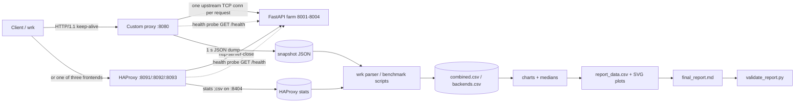
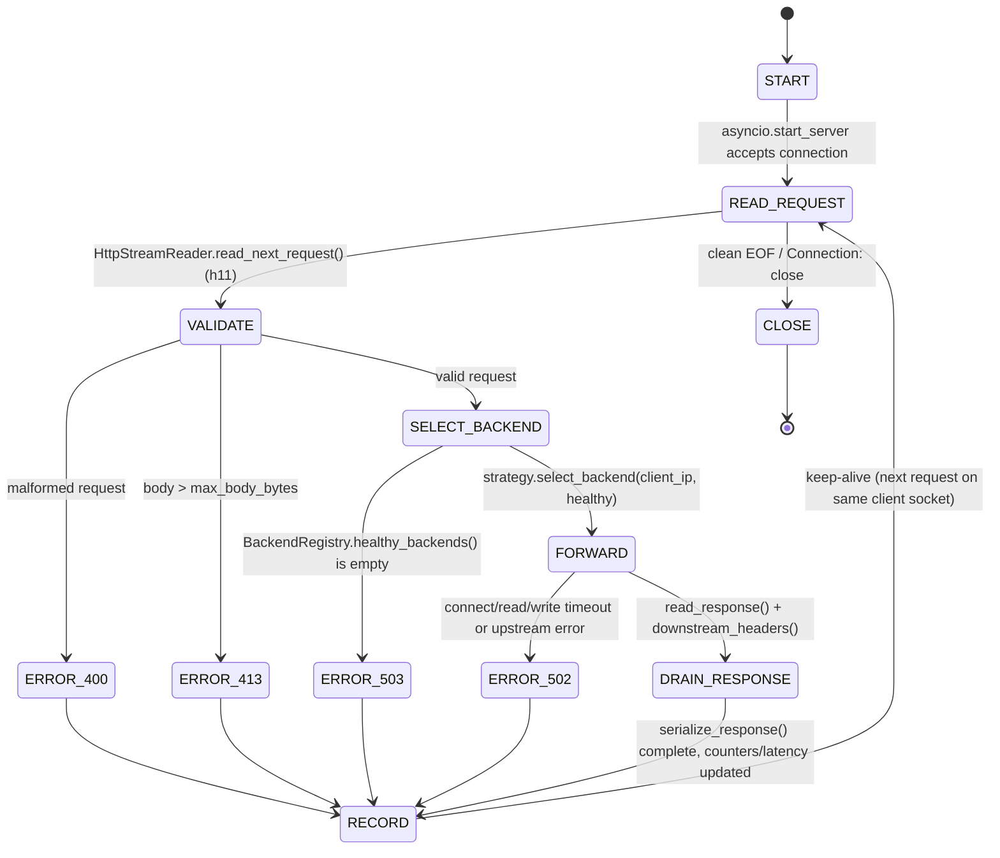
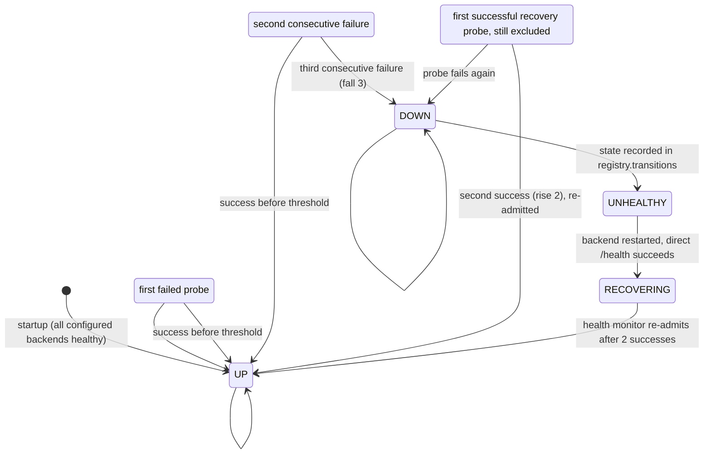
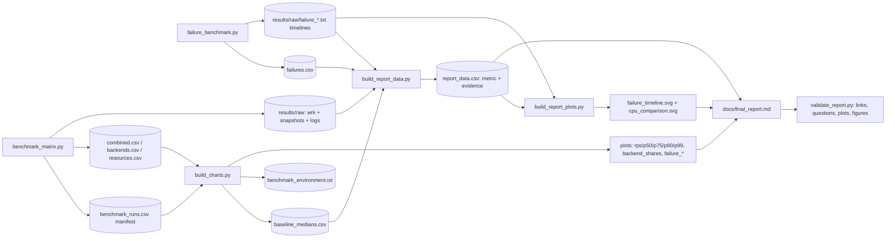

# Architecture flow — how data moves through the project

This document describes the project as a set of state machines and pipelines.
For what each file contains, see [FILE_REFERENCE.md](FILE_REFERENCE.md); for
commands and configuration see [RUNBOOK.md](RUNBOOK.md).

## 1. The whole system in one picture



The two load balancers are never driven at the same time (fair-comparison
rule). The farm, request path and payload are shared.

## 2. Client request lifecycle (custom proxy)



Important details:

- `START → READ_REQUEST` lives in `proxy.ProxyServer._handle_client`; the h11
  parser is `http_connection.HttpStreamReader`.
- `SELECT_BACKEND` calls `BackendRegistry.healthy_backends()` then the active
  strategy (`round_robin`, `least_active_requests` or `ip_hash`). The registry
  is the only source of health truth; the proxy never probes backends itself.
- `FORWARD` opens **one new upstream TCP connection per request** (no pooling),
  rewrites `Host`, strips hop-by-hop headers and applies 5 s connect /
  30 s request+write timeouts.
- `DRAIN_RESPONSE` fully consumes the upstream body before releasing the
  `Backend.active_requests` slot; that counter is what least-active selects on.
- `RECORD` increments `counters` (`requests_total`, `connections_total`,
  `responses_5xx`, `errors`, per-status counts) and appends a monotonic
  full-request lifetime to `latencies_ms`.
- Error edges: 400 malformed, 413 oversized body, 502 upstream failure,
  503 no healthy backend. The custom proxy never claims HAProxy's 503/502
  mapping is identical.

## 3. Backend health states (custom boolean + HAProxy transitional statuses)

The custom proxy stores one boolean `Backend.healthy` plus timestamped
transitions; HAProxy prints transitional `UP n/m` / `DOWN n/m` while its
fall/rise counters drain. The diagram below uses HAProxy's labels for the
transitional steps — only plain `DOWN` means out of rotation and only plain
`UP` means fully re-admitted in both implementations.



Notes:

- `UP n/m` and `DOWN n/m` are the *transitional* statuses HAProxy prints while
  its fall/rise counters drain. **They still describe rotation membership**:
  `UP 2/3` receives traffic, `DOWN 1/2` does not. Custom snapshots use the
  boolean `Backend.healthy` and a `state_transitions` list instead.
- Probe contract: `GET /health HTTP/1.1`, success iff status 200, interval 1 s,
  timeout 1 s, `fall 3`, `rise 2`. HAProxy mirrors the same knobs.
- On this Windows host a TCP connect to a killed container is silently dropped,
  so each failed probe consumes `timeout + interval`; detection lands around
  `3 × (timeout + interval)` with up to one interval of phase jitter.
- Health state changes are recorded with timestamps in `BackendRegistry` and
  consumed by the snapshot collectors; HAProxy transitions are polled from the
  stats CSV in `failure_benchmark.HealthWatcher`.

## 4. Metrics snapshot pipeline

```mermaid
flowchart TD
    A[proxy.counters + latencies_ms] --> C[collect_run_snapshot]
    B[BackendRegistry.snapshot] --> C
    C --> D{metrics dump enabled?}
    D -->|yes| E[metrics.dumper.dump_loop: atomic JSON every 1 s]
    D -->|no| F[manual snapshot at end of run]
    G[wrk console output] --> H[parse_wrk_output]
    E --> I[wrk_parser.append_combined_csv]
    F --> I
    H --> I
    I --> J[(combined.csv: 24 columns, mode=custom|haproxy)]
    C --> K[(backends.csv: per-backend rows)]
    L[HAProxy /stats;csv] --> M[parse_haproxy_stats_csv]
    M --> N[synthesize_snapshot: same shape, latency percentiles empty]
    N --> I
```

The snapshot shape is deliberately shared: `meta`, `proxy.counters`,
`proxy.latency_ms`, `backends[]`. That is why `combined.csv` can hold both
implementations with a single schema and a `mode` column.

## 5. Benchmark and report pipeline



Each stage is reproducible independently; raw evidence is kept under
`results/raw/` (gitignored) so the tracked summaries can be regenerated.

## 6. Why the states differ between the two LBs

- Custom `least_active_requests` reads `Backend.active_requests` (in-flight
  HTTP requests). HAProxy `leastconn` counts server-side connections plus
  queued work. With keep-alive client connections and one upstream connection
  per request the numbers are often close, but the definitions are not equal.
- Custom `ip_hash` uses SHA-256(client IP) mod the healthy-set size; HAProxy
  `source` uses its own map hash. Both remap some clients when backends join or
  leave; the exact remapping differs.
- A persistent client connection can carry hundreds of requests, so
  `connections_total` (11 in one HAProxy demo snapshot) can be far smaller than
  `requests_total` (11,005). That is why Q9 of the final report distinguishes
  connections from active requests.

## 7. Reading order

1. [FILE_REFERENCE.md](FILE_REFERENCE.md) — what each file does.
2. [benchmark_matrix.md](benchmark_matrix.md) — how the dataset was produced.
3. [haproxy_setup.md](haproxy_setup.md) — reference LB configuration.
4. [final_report.md](final_report.md) — results and conclusions.
